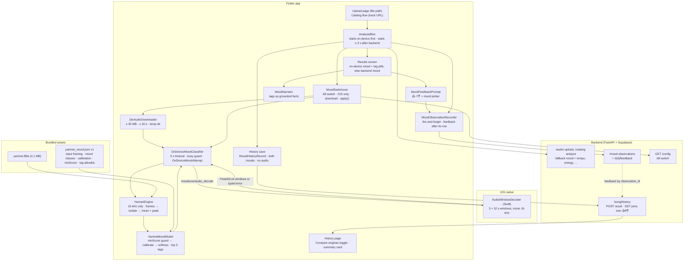

# On-device Mood Classification: Mobile System Design Showcase

Notes for rebuilding this later and presenting it in mobile system design interviews. Concept-level in the interview sections; no secrets. Build status lives in [on-device-mood-build-log.md](on-device-mood-build-log.md); the plan is [ROADMAP.md §6](ROADMAP.md).

_Last updated 2026-10-16 (evening) · Backend telemetry and kill switch live in production; OD-6 parity spike done; History compares both engines (PRs #10, #33). First TestFlight build with the on-device mood is being uploaded; still no physical-phone YAMNet numbers._

## The problem in one paragraph

MoodTune tells you the mood of a song you upload or pick from a free catalog. Today a Python backend guesses it from hand-tuned rules (tempo, brightness, loudness), and on a 200-track test it was right 32% of the time against a 25% chance baseline. A 4 MB audio model, YAMNet, scored 44% on the same tracks and is small enough to ship in the app. So the job is to classify mood on the phone, without making the results screen slower or less reliable, while the backend stays the fallback.

## Requirements and constraints

**Functional**

- Classify the mood of a local audio file (upload) or a downloaded catalog clip into one of the backend's five labels, which the app shows as four moods.
- Produce 2–3 sound tags (instruments, vocals, a few genres) that later ground the on-device narration.
- On any failure, keep the backend's result. The user never sees an error caused by this path.
- Record every result with both engines' labels, and ask "Does this feel right?" so user picks can grade both engines.
- Save each signed-in upload or catalog result to History with both engines' moods, and let the developer see how the engines compare (a toggle, off by default).
- OD-6: compute the backend's four audio rows (tempo, energy, brightness, texture) and its mood rule from the same decoded windows, so uploads need not go to the server.

**Non-functional**

| Constraint | Target | Source |
|---|---|---|
| Latency | p95 < 1 s on the oldest supported devices; hard timeout 5 s. Measured so far only on an iPhone 16 Pro **simulator**: 53–56 ms warm, 95 ms cold incl. model load. Phone: pending | OD-4 gate; `OnDeviceMoodClassifier.timeout`; PRs #26, #27 |
| Results screen | Never waits more than 3 s for on-device once the backend has answered; a backend error shows at once | `AnalysisBloc.onDeviceGrace` |
| Catalog download | ≤ 30 MB, ≤ 20 s total, deleted afterwards | `DioAudioDownloader` |
| UI smoothness | No inference on the UI isolate | `YamnetEngine` uses `Isolate.run` |
| App size | +~4 MB (`yamnet.tflite` 4.1 MB, config 7 KB) | `assets/models/` |
| Accuracy | Beat the backend: 44% vs 32% on 200 tracks (M4 Pro, Jamendo tags as truth) | Spike §4.3 |
| Reliability | < 2% on-device failures before cutover | OD-4 gate |
| Platforms | iOS first (deployment target 15.0); Android falls back to the backend until its decoder exists | PR #24 |
| Privacy | Classification needs no network; in today's hybrid mode the file still goes to the backend for the other rows. Telemetry holds labels, model outputs, fixed failure categories and coarse device info: no titles, filenames, paths, URLs or audio. History rows (the user's own, RLS-protected) hold the title but never audio | ROADMAP §6.1; `MoodObservation`; `POST /song/history` |
| OD-6 parity | Phone-computed rows must match the backend's labels before they replace them: energy 92%, brightness 91% (after ×1.218), texture 95%, tempo 84% within 4%; backend mood rule 82% (M4 Pro, 200 tracks, NumPy emulation) | `spikes/clap/05_feature_parity.py` |
| Control | Remote kill switch, cached 10 min, fails open | backend `GET /config` (`ON_DEVICE_MOOD_ENABLED`) |
| Licensing | YAMNet is Apache 2.0; notice shown in the app's licenses | `registerYamnetLicense()` |

**Out of scope:** Spotify library tracks (there's no audio on the device for them). The tempo, energy, brightness and texture rows stay on the backend until the OD-6 Dart port lands; the spike says they can move.

## Architecture

| Layer | Component | Responsibility | File |
|---|---|---|---|
| Native | `AudioWindowDecoder` | Seek and decode only three windows; downmix; resample to 16 kHz | `ios/Runner/AudioWindowDecoder.swift` |
| Native | Channel handler | `decodeWindows`; off the main thread; typed errors | `ios/Runner/AppDelegate.swift` |
| Data | `AudioDecodeChannel` | Validate the window spec, call native code, map errors to `AudioDecodeException` | `lib/features/on_device_mood/data/audio_decode_channel.dart` |
| Data | `YamnetEngine` | Reject non-16 kHz audio, frame windows, run LiteRT in an isolate, pool scores | `.../data/yamnet_engine.dart` |
| Data | `loadYamnetMoodModel` | Load the exported config; refuse another version or other framing | `.../data/yamnet_assets.dart` |
| Data | `DioAudioDownloader` | Fetch a catalog track into its own temp directory, size- and time-capped | `.../data/dio_audio_downloader.dart` |
| Domain | `YamnetMoodModel` | Scores → no mood, or calibrated mood + tags (pure Dart) | `.../domain/yamnet_mood_model.dart` |
| Domain | `AudioWindowDecoder`, `AudioClassifierEngine`, `AudioDownloader` | Interfaces that keep the native code, runtime and network replaceable | `.../domain/` |
| Presentation | `OnDeviceMoodClassifier` | Orchestrate, time out, refuse re-entry, report `OnDeviceMoodAttempt` | `.../presentation/on_device_mood_classifier.dart` |
| Presentation | `MoodSwitchover` | Kill switch and platform check, download, then merge the on-device mood into the backend result | `.../presentation/mood_switchover.dart` |
| Presentation | `AnalysisBloc` | Run both engines side by side, bound the wait, emit the displayed result | `lib/features/analysis/presentation/bloc/analysis_bloc.dart` |
| Presentation | `MoodObservationRecorder`, `MoodFeedbackPrompt` | Record each result and the user's verdict | `lib/features/mood_feedback/` |
| Backend | `mood_observations`, `app_config` | Store observations and feedback; serve the kill switch | `moodtune-backend/app/api/v1/` |
| Presentation | `AnalysisBloc._saveToHistory`, `ResultHistoryRecord` | Save the shown result with both engines' moods after it's displayed; reload loaded history | `lib/features/analysis/` |
| Presentation | `EngineComparisonPreference`, `EngineComparisonSummary`, `HistoryRowItem` | Toggle (stored on device), per-row comparison line, agreement and who-was-right summary | `lib/features/analysis/presentation/engine_comparison.dart`, `lib/shared/widgets/history_row_item.dart` |
| Backend | `/song/history` | Save a result (auth); list history with the caller's own feedback joined in | `moodtune-backend/app/api/v1/song_analysis.py` |

**Data shapes through the pipeline**

| Step | Shape |
|---|---|
| Decoder output | 3 windows × 160,000 float32 samples (10 s at 16 kHz), from 25/50/75% of the track |
| Framing | 15,600-sample frames, 7,680 hop → 19 frames per window, ~57 per track |
| Model output | 521 AudioSet class scores per frame |
| Pooling | mean (mean of window means) and peak, 521 values each |
| Mood | 5 mood classes → none reaches `minScore` (5e-4)? no mood → else log, minus each label's reference mean → softmax → top label |
| Tags | 61 allowlisted classes → best peak per display tag → top 3 |
| Displayed | Backend result with on-device `primaryMood` and tag pills; confidence ring hidden; backend label kept as `backendPrimaryMood` |
| Recorded | Observation: both labels, tags, probabilities, latency, failure category, platform, OS, device model, app version |

## Build order (rebuild from scratch)

1. **Spike offline first.** Build an evaluation set with a baseline (the current engine) before touching the app. Use 200+ items; 40 gave misleading results.
2. **Freeze the model's interpretation as data.** Export class indices, input framing, calibration constants, a no-signal floor and the tag allowlist to versioned JSON. Use the same Python that was evaluated, and commit that script next to its output.
3. **Golden fixtures that exercise every branch.** Include a no-signal case and values exactly on each cutoff. Derive expectations with the port's numeric types (float32). Check each fixture really keeps and drops something.
4. **Native decoder with a parity harness.** Compile the Swift decoder into a command-line tool and diff its output against the Python pipeline before wiring any channel.
5. **Channel with typed errors and validation on both sides.**
6. **Pure Dart interpretation that mirrors Python,** checked by the golden fixture.
7. **Inference engine:** lazy single interpreter, background isolate, a pure pooling function you can unit-test without the runtime. Reject input it wasn't built for (sample rate).
8. **Facade with timeout, re-entry guard and a result object.** It returns mood, elapsed time and a fixed failure category, never error text. Register it in DI.
9. **Device integration test** on a physical phone; record the first real latency numbers.
10. **Telemetry and feedback first:** an observation per result (both engines, latency, device, failure category) and "Does this feel right?". Ship the backend endpoints and migration before the app needs them.
11. **Kill switch** served remotely, cached, failing open.
12. **Run both engines side by side** with a bounded wait after the backend, either dark (shadow) or shown. Decide that from how much traffic you have and how bad the incumbent is. Gate on the data before calling it done.
13. **Make the comparison visible to yourself early.** Save both engines' answers with each user-facing record, and give the developer a toggle that shows agreement and who the users back. Dogfooding catches things a dashboard query never will.
14. **Before porting any server-side feature, run a parity spike** that computes it the way the phone will (same windows, sample rate and plain math you can port) against the server on the full evaluation set. Fix drift (sample-rate scaling) in the spike, then export fixtures for the port.
15. **Android decoder,** recalibration from collected data, and a temperature fit before showing confidence.

## Concepts

### 1. Choosing a model under mobile constraints (OD-0)

**What we did.** We compared the rule-based backend, CLAP (two variants), YAMNet, and a blend of CLAP and YAMNet on 200 Jamendo tracks, 50 per mood, using artist tags as noisy truth. YAMNet won for the phone: 44% at 4 MB and ~30 ms per track on an M4 Pro CPU.

**Alternatives and trade-off.**

| Option | Accuracy (95% CI) | Size | Why not |
|---|---|---|---|
| CLAP general, calibrated | 50% (44–57) | 34 MB int8 | Needs a log-mel front-end ported to Swift and Kotlin, the riskiest step; 8× the size |
| CLAP + YAMNet blend | 48% (41–55) | 38 MB | No gain at 200 tracks |
| CLAP music | 28% (23–35) | ~78 MB | At chance; likely a bad conversion |
| Rule-based backend (today) | 32% (26–39) | — | Rarely predicts `charged`; calls most `serene` tracks `reflective` |

YAMNet sits inside CLAP's confidence interval at a tenth of the size. It computes its own spectrogram inside the `.tflite`, so there's no DSP code to port. Its 521 classes also include instruments and vocals, which narration needs.

**Rebuild playbook.**

1. Define the label space and a baseline.
2. Build a balanced set and report confidence intervals, not single numbers.
3. Measure accuracy, size and latency together.
4. Prefer the model whose input pipeline you don't have to port.

**Interview version.** "I benchmarked candidate models offline against our existing engine before writing any app code. The bigger model was slightly more accurate, but within the noise, while YAMNet was 8× smaller. It also takes raw audio, so I didn't have to reimplement a spectrogram on two mobile platforms. On a phone, size and porting risk matter as much as accuracy."

- *How did you know 44% vs 50% wasn't a real difference?* 95% confidence intervals on 200 tracks overlap (37–51 vs 44–57). Differences under ~10 points aren't settled at that size.
- *Why not run the bigger model on a server?* That keeps a network round trip on the critical path and sends audio off the device. The point was a faster, private path with the server as fallback.

### 2. Splitting work across the platform channel (OD-2, OD-3)

**What we did.** Native code only decodes audio. Framing, inference orchestration, calibration and tags are all Dart.

**Alternatives and trade-off.** Running inference natively (Core ML or LiteRT in Swift, and again in Kotlin) means writing the logic twice and testing it twice. Doing decoding in Dart isn't possible either, since Dart has no AAC or MP3 decoders. The thin native layer keeps the platform-specific part small, and a decoder like it can be reused for upload trimming or a future on-device CLAP.

**Rebuild playbook.**

1. Draw the boundary at the first step that needs platform codecs.
2. Make the channel contract explicit: method, arguments, reply shape and error codes.
3. Hide it behind a Dart interface (`AudioWindowDecoder`) so tests use fakes.

**Interview version.** "I kept native code to the one job only the platform can do, decoding compressed audio, and did everything else in Dart. Both platforms then share one tested implementation of the model logic, and the native surface is a single method with typed errors."

- *What crosses the channel and how big is it?* Three `Float32List` windows of 160,000 samples, about 1.9 MB per track, sent as typed data rather than boxed lists.
- *What if Android isn't ready?* The switchover checks the platform first and skips the on-device path (`unsupported`), so Android keeps the backend's result without downloading a track or loading the model. A missing handler would still map to `unavailable` and fall back.

### 3. Bounded audio decoding: three windows, not the whole file (OD-2)

**What we did.** The decoder seeks to 25%, 50% and 75% of the track and decodes three 10 s windows, mono at 16 kHz. Short files come back whole as one window.

**Alternatives and trade-off.** Decoding the whole file costs time and memory in proportion to its length, and a 10-minute track would blow the budget. One window is cheap but can land on a quiet intro or a bridge. Three windows bound the cost (~200 ms for a 4.5 min stereo MP3 on an M4 Pro) and match what the spike evaluated.

**Rebuild playbook.**

1. Read the duration.
2. Compute the window starts.
3. Seek and read only those frames.
4. Downmix by averaging channels.
5. Resample with the platform converter.
6. Trim or pad each window to an exact length.

**Interview version.** "Inference cost should not depend on how long the user's song is. I sample three fixed windows across the track, which caps decode and model work and gives the model a beginning-middle-end view."

- *Why 16 kHz mono?* YAMNet's input is 16 kHz mono; converting once in native code is cheaper than in Dart.
- *Does sampling hurt accuracy?* The spike evaluated exactly this sampling, so the 44% already includes it.

### 4. Proving parity across languages (OD-1 to OD-3)

**What we did.** Parity was checked at three layers:

- **Decoder vs librosa.** The Swift decoder, built as a macOS tool, matched librosa: 20/20 labels, per-window correlation 0.97–1.00, worst score difference 0.005.
- **Python vs Dart interpretation.** A golden fixture exported by the spike checks that the Dart `interpret` matches the Python one.
- **The whole pipeline on a device.** An integration test runs it end to end, with tolerances of 0.02 (mean) and 0.05 (peak).

Two parity traps showed up in review:

- **A vacuous fixture.** The tag-cutoff golden used a threshold above every tag score, so it always expected no tags and passed whatever the code did.
- **A float32 gap,** exposed once the cutoff test actually ran. Python derived expectations from float64 values, but Dart reads the fixture into `Float32List`s, so a tag exactly on the cutoff disagreed.

The generator now uses float32 and puts the cutoff exactly on a real tag score. Tests assert that the cutoff both keeps and drops tags, and a `>` mutation fails.

**Alternatives and trade-off.** Comparing only final labels hides drift until it flips one. Comparing raw samples is too strict, because resamplers differ slightly. Comparing class scores with a tolerance catches real drift but allows codec noise.

**Rebuild playbook.**

1. Export goldens from the reference implementation.
2. Test each port against them, layer by layer.
3. Set tolerances from a measured worst case, not a guess.
4. Make the reference compute in the port's numeric types.
5. Put fixture values on the boundaries, and mutation-check one comparison to prove the test can fail.

**Interview version.** "The model was evaluated in Python but runs in Swift and Dart, so I treated Python as the reference and checked each port against exported goldens. That way, a later accuracy change means the model, not a bug in my port."

- *What would break parity?* A different resampler, channel downmix, frame hop, or forgetting to pad the last frame.
- *Where do the test inputs come from?* A synthetic chord generated by the same formula in Python and Dart, so no audio file is bundled.
- *How do you know your parity test can fail?* Flip one comparison (`>=` to `>`) and check the test goes red; also assert that the fixture exercises both sides of each branch.

### 5. Inference off the UI thread (OD-3)

**What we did.** `YamnetEngine` loads one LiteRT interpreter lazily and allocates its tensors. It then runs all ~57 frames in a single `Isolate.run`, which rebuilds the interpreter from its native address in the worker isolate. Calls queue so only one runs at a time, and a failed load is retried on the next call.

**Alternatives and trade-off.**

- One isolate per frame pays the spawn cost 57 times.
- A long-lived worker isolate is faster per call but adds lifecycle code.
- Running on the UI isolate is simplest, but drops frames.

One `Isolate.run` per track is the middle ground.

**Runtime: `flutter_litert` over `tflite_flutter`.** Both wrap the same engine, LiteRT (TensorFlow Lite's 2024 name), so the choice is about the Flutter wrapper:

| | `tflite_flutter` | `flutter_litert` (chosen) |
|---|---|---|
| Publisher | tensorflow.org (official) | Community fork (hugo.ml) with the same `Interpreter` API |
| Last release (as of 2026-10-16) | 0.12.1, ~11 months earlier | 3.9.4, days earlier |
| iOS simulator | "Inference may not work" | No caveat |
| Release IPA | Known "symbol not found" failure unless Xcode's strip style is changed | No caveat |
| Native libraries | Downloads on mobile, built manually on desktop | Bundled; Swift Package Manager or CocoaPods on iOS |

Being able to test on simulators and build release IPAs without workarounds outweighed the official publisher. The shared API keeps the switching cost low if the community fork stalls. The Android 16 KB page-size requirement is unconfirmed for either and gets checked when the Android decoder lands.

**Rebuild playbook.**

1. Choose the runtime wrapper by what blocks you day to day: simulator inference, release builds, packaging and release activity, as well as who publishes it.
2. Load once, lazily.
3. Pass only sendable data (the interpreter address and the windows) to the worker.
4. Keep the pooling math a pure static function so it's testable without the native runtime.
5. Serialise access, because one interpreter can't run concurrently.

**Interview version.** "Model inference is CPU-bound, so it runs in a background isolate and the UI keeps rendering. I load the interpreter once and hand its native address to the worker, so there's no reload per request. Pooling is a pure function, so most of the logic is unit-tested without a device."

- *What happens if two tracks are classified at once?* The engine queues runs, because one interpreter can't run two inferences concurrently. The classifier above it refuses a new attempt (`busy`) while a timed-out one is still running, so uncancellable work can't pile up.
- *How would you cut latency further?* Measure first on a phone (pending). Then try the GPU or Core ML delegate, a quantized model, fewer windows, or a warm-up at app start.
- *Why a community package over the official TensorFlow one?* Same engine, same API. The official wrapper hadn't shipped in about 11 months and has known simulator and IPA problems. The fork is actively released and bundles its libraries, and switching back is an import change.

### 6. Pooling: mean for mood, peak for tags (OD-1, OD-3)

**What we did.** Mood uses the mean score over frames. Tags use each class's peak frame score.

**Alternatives and trade-off.** Averaging dilutes an instrument that plays in only part of a song. With mean pooling, 87% of tracks got no tag at all; with peak pooling, 52% got 2–3 tags. Peak pooling is more prone to one-frame false positives, which the listening sheet checks. Mood stays on the mean because that's what was evaluated.

**Rebuild playbook.**

1. Choose the pooling per output, by how the signal shows up over time.
2. Validate it by listening, not only by metrics.

**Interview version.** "Different outputs need different aggregation. A mood is a property of the whole track, so I average it; an instrument might only appear in the chorus, so I take its strongest moment."

- *How do you stop one noisy frame from adding a tag?* An allowlist of reliable classes, a cap of three tags, and a score threshold that's still to be set.
- *Why not use a percentile?* The 90th percentile gave tags on only 16% of tracks.

### 7. Calibration and honest confidence (OD-1, OD-5)

**What we did.** Raw zero-shot scores are biased toward common classes such as "Happy music". Each mood's log-score is centred on its mean over reference tracks; the constants ship in `yamnet_mood.json`, and no labels were needed. Softmax then picks the top label. The probability is logged, not shown, until it's checked against real outcomes.

**Correction (2026-10-16).** The synthetic chord's 95% "angry" was first read as softmax overconfidence. The real cause was no signal: all five mood classes scored 0, so softmax compared `log(1e-9)` minus each reference mean, and "angry", with the lowest mean, won. A temperature can't fix that. `mood.minScore` (5e-4) now turns "no mood class fired" into "no mood", and the backend's label is kept. Only 1 of the 200 reference tracks falls below it.

**Alternatives and trade-off.**

- **Raw scores** also scored 44%, but over-predict `upbeat`.
- **Calibrated scores** over-predict `reflective` instead. Which to keep is still to be decided on a held-out split.
- **A temperature fit** on real user labels is the planned fix for the overconfidence (OD-5).

**Rebuild playbook.**

1. Check the label distribution of predictions before trusting accuracy.
2. Centre scores per label.
3. Guard against no-signal input before normalising: softmax always produces a winner.
4. Don't display a probability until it's checked against observed accuracy.

**Interview version.** "Zero-shot models carry label bias, so I subtract each label's average score, which needs no labelled data. The resulting probabilities were badly overconfident, so the UI shows the label but not a confidence number until I can fit it on real user feedback."

- *How will you get labels?* Shadow mode adds a "Does this feel right?" prompt with a mood picker; those answers grade both engines and fit the temperature.
- *What if calibration constants don't suit real uploads?* They were fitted on Jamendo, so they get recomputed from the recorded observations.
- *What does your model say for silence?* Nothing. Softmax always picks a winner, so a floor on the raw mood scores comes first; below it, the server's answer stands.

### 8. Model behaviour as data (OD-1)

**What we did.** The mood classes, calibration means, tag allowlist, tag cap and threshold all live in `yamnet_mood.json`. It's exported by the same Python script that was evaluated and parsed by `YamnetMoodModel.fromJson` with strict pattern matching.

**Alternatives and trade-off.** Hard-coding the constants in Dart is simpler, but every retune would need a code change and could drift from Python. A JSON asset changes with a rebuild, and a remote config could later change it without one. Strict parsing turns a bad export into a `FormatException`, which becomes a fallback.

**Rebuild playbook.**

1. Make one source of truth (the export script), committed next to what it generates.
2. Version the file (`"version": 1`) and record the input it assumes (sample rate, frame, hop).
3. Parse it strictly, and refuse a version or framing the engine doesn't match. Otherwise it loads fine and scores the wrong windows.
4. Check cross-field consistency (every mood label has a calibration mean).
5. Test it with a golden fixture.

**Interview version.** "Everything that interprets the model is data exported from the evaluation code, so retuning is a re-export, not a code change. It's also the path to remote tuning later."

- *Why not load it remotely now?* There's no need yet, and a bundled file works offline. Remote config makes sense with a kill switch at cutover.
- *What protects against a bad file?* Strict parsing plus the fallback: a bad config means the backend's mood is shown.

### 9. Fallback contract and timeouts (OD-3, OD-5)

**What we did.** `OnDeviceMoodClassifier.attempt` returns an `OnDeviceMoodAttempt`: the mood or null, the elapsed time, and a fixed failure category. Every failure keeps the backend's mood:

| Category | Meaning |
|---|---|
| `disabled` | The remote kill switch is off |
| `unsupported` | No native decoder (Android), so nothing is downloaded or loaded |
| `download: <type>` | Catalog download failed, e.g. `receiveTimeout` |
| `busy` | A timed-out attempt is still running |
| `timeout` | Past the 5 s deadline |
| `no_mood` | No mood class reached `minScore` |
| `late` | The backend answered and 3 s passed without the on-device result |
| `decode: <code>` | Native decoder error code |
| `classification_failed` | Anything else (model load, inference) |

This is the same contract as narration: an engine interface, one deadline, a null fallback, and a results screen that never waits long on the model.

**Alternatives and trade-off.** Throwing errors makes every caller handle them. Blocking the result on the model puts its latency on the critical path. The timeout can't cancel native decoding or the isolate, so the classifier refuses new attempts until the old work finishes. Failures are categories, not error text, because Dio and decoder errors can include the track URL or the file path, and these go into telemetry.

**Rebuild playbook.**

1. Return a result object (value or null, elapsed, reason).
2. Make reasons a closed set of categories that are safe to send off the device.
3. Use one timeout for the whole attempt, and gate re-entry if the work can't be cancelled.
4. Retry a failed model or config load on the next call instead of caching the failure.
5. Cap each external step on its own: a network timeout bounds gaps between bytes, not the total.

**Interview version.** "The on-device path is an optimisation, never a dependency. Any failure, from a missing decoder to a timeout, returns a reason and the screen shows the server's answer. The reasons are a fixed vocabulary, so I can chart failure rates per device without leaking user data."

- *How do you know it's failing?* Every result is recorded with its failure category, latency and device model, so failure rate per category and device is one query.
- *Why 5 s when the target is 1 s?* The timeout is a safety net for the work itself; the screen has its own 3 s bound after the backend, and the 1 s p95 is the quality bar.
- *What if the work can't be cancelled?* Stop waiting, and refuse to start more until it finishes, so a slow phone doesn't queue up CPU-heavy jobs.

### 10. Rollout: kill switch, side-by-side logging and gates (OD-4, OD-5)

**What we did.** The plan was shadow mode first (run dark, log, then cut over at a gate). PR #27 instead shipped the cutover and the data collection together:

- the on-device mood is shown for uploads and catalog tracks;
- every result records both engines' labels, latency, device and failure category;
- users answer "Does this feel right?";
- a remote kill switch can turn the on-device path off without a release.

The gate is unchanged: p95 under 1 s on the oldest devices, failures under 2%, and agreeing with users more often than the backend. It now gets measured after cutover instead of before. The reason for skipping the shadow period is pending.

**Alternatives and trade-off.**

| Option | Gain | Cost |
|---|---|---|
| Shadow first (planned) | Ground truth and device data with no user risk | Needs real traffic during the dark period; users keep the weaker engine meanwhile |
| Cut over with kill switch + logging (chosen) | Users get the engine that scored better offline (44% vs 32%); data collection starts at once | Users see unmeasured phone behaviour; the kill switch is the only brake |
| A/B test | Clean comparison | Needs more users than either |

**Rebuild playbook.**

1. Build the telemetry and feedback loop before the switchover, so the first result is already measured.
2. Serve a kill switch remotely, cache it briefly, fail open (or closed, if the new path is risky).
3. Record what was displayed and what the other engine said, so disagreement is visible per result.
4. Gate with numbers, and write down the gate before looking at the data.

**Interview version.** "I wouldn't trust an offline benchmark for a model running on thousands of different phones. So every result records both engines, the latency and the device, and users can say whether the mood fits. The on-device path sits behind a remote kill switch. Whether it runs dark or visible first depends on traffic and on how weak the incumbent is; either way, the gate is latency, failure rate and agreement with users."

- *What's the feedback loop?* A thumbs-down opens a mood picker; those labels grade both engines and later fit a temperature and train a small head on YAMNet's embeddings (OD-7).
- *What metric matters most?* Agreement with user picks, with p95 latency as a hard gate.
- *Why fail open on the kill switch?* The on-device path already falls back on every error, so an unreachable config server shouldn't disable it. A riskier feature would fail closed.

### 11. Grounding narration in sound tags (OD-5)

**What we did.** Sound tags go into `NarrationInput` ("You can hear vocals and piano"). `MoodNarrator` may name an instrument, vocals or a genre only when a tag backs it. The guarded vocabulary is checked against every tag in `yamnet_mood.json`. An early hand-written list missed banjo, flute and organ (cubic, PR #27). This also closed an old gap: "jazz", "metal" and "hip hop" are now allowed only when heard.

**Rebuild playbook.**

1. Pass detected facts to the generator as input.
2. Validate the output against those facts.
3. Derive the validator's vocabulary from the same config the detector uses, and test that they match.

**Interview version.** "The classifier gives the language model facts it was missing. A word like 'piano' is allowed in the narration only when the audio model detected piano, and the list of guarded words comes from the model's own tag config, so it can't drift."

- *What if the language model mentions an unheard instrument anyway?* Validation rejects the narration and the fixed reasoning text is shown instead.

### 12. Platform gaps (OD-2 · open)

- **Android:** `MediaExtractor` + `MediaCodec`, then mono and 16 kHz. Android has no public resampler, so we need a windowed-sinc implementation or a small library. This is the biggest unknown.
- **Ogg on older iOS:** unconfirmed. Unsupported files return `unreadable` and fall back.
- **Android today:** `MoodSwitchover.isSupported` is false, so nothing is downloaded or loaded only to fail at decode (fixed after cubic review, PR #27).

### 13. Running two engines side by side on the results path (OD-5)

**What we did.** `AnalysisBloc` starts on-device classification before the backend request, so the two overlap. When the backend answers:

- on error, the error shows immediately;
- on success, the bloc waits at most 3 s (`onDeviceGrace`) for the on-device attempt, then `MoodSwitchover.apply` swaps the on-device mood and tags into the backend's result.

Tempo, energy and the other rows stay the backend's, and the backend's label is kept as `backendPrimaryMood`. A catalog track is first downloaded to its own temp directory (≤ 30 MB, ≤ 20 s), which is deleted afterwards.

**Alternatives and trade-off.**

- **Sequential** (on-device, then backend) adds both latencies.
- **On-device only** loses the rows the phone can't compute yet.
- **Waiting without a bound** lets a slow phone hold the screen hostage.
- **Updating the screen later** when on-device arrives makes the mood visibly change under the user.

Concurrent work plus a bounded grace period means the screen is never much slower than today. A slow phone shows the backend mood and records `late`.

**Rebuild playbook.**

1. Start the local work before the network call.
2. Fail fast on server errors.
3. Bound the extra wait relative to the server's answer, not to the start.
4. Merge into the server's result object so the UI needs one new field (`source`), not a new screen.
5. Keep the other engine's answer on the result for logging.

**Interview version.** "The phone and the server work at the same time. When the server answers, I give the on-device result a short grace period. If it's there, it replaces the mood; if not, the server's mood shows and the miss is logged as late. The user never waits on the slower of the two for long."

- *Why 3 s?* A bound on how much slower the screen can get than today; the real target is on-device finishing well before the backend (p95 < 1 s). Phone numbers will tell whether 3 s is generous or tight.
- *What does the user see if the moods disagree?* Only the displayed one. Both are recorded, and the feedback prompt asks the user, which is how disagreement becomes data.

### 14. Privacy-safe telemetry and the feedback loop (OD-4)

**What we did.** Every upload or catalog result creates a `MoodObservation`, identified by a client-generated UUID. It holds:

- source, the backend label, and the on-device label, tags, probabilities and latency;
- the failure category, and what was displayed (and from which engine);
- platform, OS, device model (null on simulators) and app version.

The recorder sends it fire-and-forget to `POST /mood-observations`. "Does this feel right?" sends 👍, or 👎 plus a picked mood, to `PATCH /mood-observations/{id}/feedback`. The recorder holds feedback until its observation is stored, so the backend never gets feedback for a missing row. The backend validates labels and tags, and returns generic errors.

**Alternatives and trade-off.**

- **Sentry or analytics events** are easy but hard to join with later feedback.
- **Logging only locally (Talker)** gives nothing to aggregate.
- **A dedicated table** keyed by a client UUID makes "observation + verdict" one row, ready for grading engines and fitting a temperature.

The cost is public write endpoints that need abuse controls; rate limiting is still open (deferred until before OD-7 trains on the data, because a correct per-IP limit needs the real client IP behind the hosting proxy). The table has no environment column: dev and production share one backend, and the developer tests on the production build, so the developer's own rows are separated by `user_id` instead.

**Rebuild playbook.**

1. Decide the analysis you want (agreement per engine, latency per device) and design the row for it.
2. Allowlist fields; write "never add titles, files or audio" on the entity.
3. Use fixed categories, never exception text.
4. Generate the id on the client so feedback can reference it before the server responds.
5. Order dependent writes (feedback after its observation).
6. Ship the backend migration before the app depends on it.

**Interview version.** "To know whether the model works for real users, I record each result with both engines' answers, latency and coarse device info, but nothing that identifies the song or the user's files. A one-tap 'does this feel right?' attaches the user's verdict to that same record, which gives me labelled data to grade both engines and recalibrate."

- *How do you avoid leaking user data?* An explicit field allowlist, fixed failure categories instead of error strings (a review caught that a download error included the track URL), and no titles, filenames or audio.
- *What if the network is down?* Recording is fire-and-forget and never blocks the screen; a lost observation is acceptable for this purpose.

### 15. Remote kill switch (OD-5)

**What we did.** The backend serves `GET /config` → `{on_device_mood: bool}` from the `ON_DEVICE_MOOD_ENABLED` setting. The app caches it for 10 minutes, refetches if the device clock moved backwards, and keeps the last known value on network errors, defaulting to enabled.

**Alternatives and trade-off.**

- **A feature-flag service** is more capable but another dependency.
- **App-store releases** to disable a feature take days.
- **Failing closed** would turn a config outage into a feature outage.

Failing open is safe here because every on-device failure already falls back to the backend.

**Rebuild playbook.**

1. Put the flag on a cheap unauthenticated endpoint you already run.
2. Cache with a TTL measured safely (watch for clock changes).
3. Choose fail-open or fail-closed by what the flagged path can break.
4. Test the switch end to end before you need it.

**Interview version.** "Every new on-device path ships behind a server-side switch, so if a phone model misbehaves I can turn it off in minutes without a release. It's cached and fails open, because the feature already falls back safely on its own."

- *Why not per-device targeting?* Not needed yet; the recorded device model would let you add it if one model misbehaves.

### 16. Moving signal-processing features onto the phone: the parity spike (OD-6)

**What we did.** Before porting anything, `05_feature_parity.py` computed the backend's four audio rows from exactly what the phone has: three 10 s windows at 16 kHz. It used plain NumPy (frames, Hann window, FFT, median filters, autocorrelation) so each step has a direct Dart equivalent, and compared the result with the backend's librosa pipeline (up to 300 s at 22.05 kHz) on all 200 tracks.

| Row | Phone method | Agreement with backend label |
|---|---|---|
| Energy | mean frame RMS | 92% |
| Brightness | spectral centroid, then ×1.218 | 78% → 91% |
| Texture | HPSS soft masks measured in the spectrogram (no inverse STFT) | 95% |
| Tempo | mel onset flux → autocorrelation → 120 BPM prior → parabolic peak | 84% within 4%, median error 1.7 BPM |
| Mood | the backend's own rule on the phone values | 82% same label; 34% vs 32% against truth |

**Alternatives and trade-off.**

- **Port first, compare later.** Faster to start, but then you're debugging the algorithm and the port at once.
- **Decode the whole file at 22.05 kHz** to match the server exactly. That's another decode, and cost grows with track length; the three 16 kHz windows already exist for YAMNet.
- **Drop tempo** instead of porting beat tracking. It's simpler, but narration and the "fast-paced" descriptor lose a fact. The estimator reached 84%, so it stays.
- **Refit every threshold** vs **one linear map.** Refitting overfits 200 tracks; a single scale factor explains the brightness drift (a sample-rate effect) and also feeds the mood rule.

**Rebuild playbook.**

1. List the values the UI and downstream consumers actually use. Here that was four, not the backend's fourteen.
2. Write the phone version in the reference language, with only portable operations.
3. Check it on synthetic signals with known answers (click tracks, a pure tone, white noise).
4. Compare labels, not just correlations, against the server on the full set, and look for systematic drift.
5. Fix drift with the simplest explanation (a scale factor for sample rate).
6. Check that the downstream rule still agrees, and that accuracy against ground truth didn't fall.
7. Export fixtures, then port.

**Interview version.** "Before moving the server's audio features onto the phone, I emulated the phone's pipeline in Python on the exact windows the phone decodes. I measured agreement with the server on 200 tracks. One feature drifted because the phone works at a lower sample rate, and a single scale factor fixed it. The server's mood rule fed with phone values agreed 82% of the time and was just as accurate against ground truth, so the port was de-risked before writing Dart."

- *Why is 82% agreement acceptable?* The rule itself is only 32% accurate against ground truth, and the phone copy scores 34%, so the disagreements are mostly between two equally wrong answers. What matters is accuracy against truth didn't drop.
- *Why does sample rate change brightness?* The centroid is a frequency-weighted mean of the spectrum. At 16 kHz nothing above 8 kHz exists, so the mean shifts down.

### 17. Making the comparison visible: History with both engines (OD-4 data, OD-6 history)

**What we did.**

- **Saving.** Once a result is shown, the app saves it to the signed-in user's history with the backend mood, the on-device mood, which one was displayed, and the observation id. It's the result only, never audio. The backend joins the user's own 👍/👎 from `mood_observations` when listing history, scoped to the caller.
- **Viewing.** A "Compare engines" toggle, off by default and stored on the device, adds `On-device SERENE · Backend UPBEAT` plus a match mark and the attributed answer to each row. A summary card says how often the engines agreed and which one the user's answers back.
- **Catalog rows.** Catalog rows used to be saved by the server during its own analysis, before the on-device mood existed. The app now opts out of that (`save_to_history: false`) and saves the complete row itself.

**Alternatives and trade-off.**

| Option | Gain | Cost |
|---|---|---|
| SQL queries on the observations table only | No app work | The developer never sees it while using the app; no song names (that table is title-free by design) |
| An admin dashboard | All users at once | A new surface and auth to build |
| Everyone sees the comparison | Simple, transparent | Exposes internals ("backend" vs "on-device") to testers |
| A toggle in History, off by default (chosen) | The developer sees it on real songs while using the app; testers see a normal history | Per-user only; aggregate analysis still needs SQL |

**Pitfalls found in review.**

- **"Loaded" must be a state, not a non-empty list.** Otherwise a user's first saved result doesn't appear.
- **A pending preference read must not overwrite a tap.** Both waited on the same `SharedPreferences.getInstance()`.
- **A 👍/👎 has to name the engine it's about,** or it can't be attributed.

**Rebuild playbook.**

1. Keep the analytics table privacy-minimal, and join it into the user's own records for display.
2. Let the client write the final record once all engines have answered; have the server's auto-save opt out with a flag, so older clients keep working.
3. Compare at the level users see (display buckets), and define how an answer credits each engine before showing any numbers.
4. Gate developer views behind a stored toggle.
5. Test the async edges: empty state, reload after save, toggle during load.

**Interview version.** "I wanted to feel how the two engines compare on real songs, not just read a query. So every saved result carries both engines' answers, and a hidden toggle in History shows them side by side, with a summary of how often they agree and which one users' thumbs back. The analytics table stays title-free; the comparison is joined into the user's own history, which already holds their song names."

- *How do you attribute a thumbs-down to an engine?* It's about the mood that was shown. With a picked mood, whichever engine matched the pick gets the credit; without one, it isn't counted.
- *Why not let the server save catalog history as before?* It saves during its own analysis, before the phone's answer exists. The client is the only place that knows the final displayed result.

## Interview walkthrough

A 45-minute answer to "Design on-device mood classification for a music app".

1. **Clarify (3 min).**
    - Which flows have audio on the device? Uploads and a catalog clip; streaming library tracks don't.
    - Is a server engine already in place? Yes, and it becomes the fallback.
    - What are the platform floors? iOS 15, Android minSdk.
    - Is there labelled data? No, so expect zero-shot plus feedback.
2. **Requirements (5 min).** Functional and non-functional, as in the table above. Name the budget: p95 < 1 s, +4 MB, no UI jank, never worse than today.
3. **Model choice (7 min).** Concept 1: evaluate offline against the baseline, with confidence intervals. Choose on accuracy, size and porting risk together.
4. **High-level design (8 min).** Draw the diagram:
    - native decoder → typed channel → Dart engine in an isolate → pure interpretation → result object with a failure category;
    - the bloc runs it beside the server call, with a bounded grace period (13);
    - the UI merges it into the server result;
    - telemetry and feedback go to the backend (14);
    - a kill switch sits in front (15).
5. **Deep dives (12 min).** Pick two or three based on the interviewer:
    - bounded decoding (3)
    - the isolate and interpreter lifecycle (5)
    - pooling (6)
    - calibration and confidence (7)
    - config as data (8)
    - parity testing (4), including how you know the tests can fail
    - running two engines side by side (13)
    - privacy-safe telemetry and feedback (14)
    - de-risking a port with a parity spike (16)
    - making the comparison visible while dogfooding (17)
6. **Failure modes (4 min).** Use the category table (9): unsupported platform, kill switch, download, unreadable codec, model load, timeout, `busy`, `late`, no signal (silence, test tones), bad config. Each one falls back, and each is a fixed category in telemetry.
7. **Rollout and metrics (4 min).**
    - Shadow first vs cut over with logging, and when each fits (10).
    - The gate: p95, failure rate, agreement with users.
    - The kill switch, feedback as ground truth, recalibration and a temperature fit before showing confidence.
8. **Extensions (2 min).** Android decoder, GPU or Core ML delegate, fully on-device analysis (already de-risked: energy, brightness, texture and tempo from the same windows agree 84–95% with the server, concept 16), a trained head on embeddings, tags grounding narration.

## Deep-dive story seed

**Situation.** MoodTune's mood engine was hand-tuned rules, 32% accurate against a 25% chance baseline. The playlist path depended on Spotify audio features, which Spotify closed to new apps in November 2024. Uploads are the core interaction, and "your song never leaves your phone" is a product goal.

**Task.** Jordan, solo developer: find a better engine that could run on the phone, and ship it without risking the existing results screen.

**Actions.**

- Ran a 200-track offline comparison of five engines with confidence intervals, and chose YAMNet for its size and because it needs no front-end port.
- Exported the model's interpretation (calibration, tag allowlist) as versioned data, and drove parity from Python goldens.
- Wrote a bounded native iOS decoder (three windows), verified against librosa on macOS: 20/20 labels, worst score difference 0.005.
- Built the Dart engine with a lazy interpreter in a background isolate, a pure interpretation layer, and a time-boxed facade matching the narration feature's contract.
- Shipped the switchover: the on-device mood runs beside the backend with a 3 s grace period, merges into the server result, and sits behind a remote kill switch.
- Built the feedback loop: a privacy-safe observation per result (both engines, latency, device, failure category) plus "Does this feel right?", backed by new API endpoints.
- Hardened it through review: a no-signal guard (silence had read as a confident "angry"), fixed failure categories so no paths or URLs reach telemetry, a re-entry guard for uncancellable work, and golden tests made to fail when they should (which exposed a float32 parity gap).
- Deployed the telemetry, feedback and kill-switch backend to production, with validated mood labels and generic errors.
- De-risked going fully on-device (OD-6) with a parity spike: the phone's windows reproduce the server's audio rows 84–95% of the time, and its mood rule 82%, at the same accuracy against truth.
- Built a developer-facing comparison into History: both engines' moods per song, the user's attributed thumbs, and an agreement summary behind a hidden toggle.

**Working style.** Solo, pairing with Claude Code for implementation and parity tooling. The cubic review bot caught real bugs in every PR, from a decoder crash (#24) to the no-signal "angry" (#26) and a privacy leak in telemetry (#27).

**Result.** Pending. Offline it's 44% vs 32%. On an iPhone 16 Pro simulator, YAMNet takes ~55 ms warm (not a phone number). The backend is live and the first TestFlight build with the on-device mood is being uploaded (2026-10-16). Phone latency, failure rate and agreement with user picks: pending.
