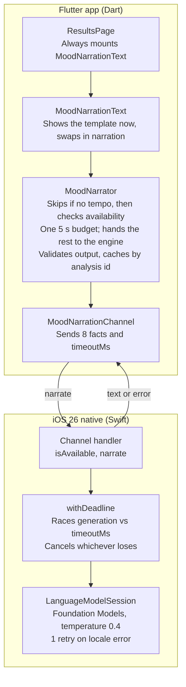

# Design doc: On-device mood narration

_As of 2026-10-13 · shipped in PR #16 (`feat/on-device-narration`)_

## Overview

On supported iPhones, the results screen replaces the backend's template mood explanation with one or two sentences written on the device by Apple's Foundation Models. Every other device and every failure keeps the template.

**Problem.** The backend's mood reasoning is template copy ("Derived from tempo, brightness, and energy patterns."). It is accurate but generic, and reads the same for every song.

**Solution.** The on-device model narrates a mood the classifier already chose, using a small set of pre-phrased sound facts. Its output is validated in Dart and dropped if it is too long, invents facts, or never names the mood. The template shows first; on-device text swaps in only if it arrives within 5 seconds. Nothing leaves the device, and the classifier stays the only source of the mood label.

## Goals and non-goals

**Goals**

- Explain each result in plain, song-specific language on devices that support Apple Intelligence.
- Never block or slow the results screen: the template renders immediately.
- Keep the classifier as the single source of truth for the mood label.
- Send no user-supplied text (title, artist, filename) and no confidence score to the model.
- Stop spending battery on generation once the result is no longer wanted (5 s deadline).

**Non-goals**

- Choosing or changing the mood. The model only narrates.
- Android or older iOS. They keep the template; no server-side LLM fallback.
- Narration for playlist or Spotify analyses. Only audio-upload and catalog results (`AudioUploadAnalysis`) are covered.
- Proving every sentence is factual. Validation blocks known kinds of invention, not all of them.

## Architecture

The feature spans three Dart layers and one Swift file, joined by the `moodtune/narration` method channel.

`MoodNarrator` is the gate: it returns the template on any failure, and only text it validates reaches the screen.

| Layer | File | Holds |
| --- | --- | --- |
| Domain | `lib/features/narration/domain/narration.dart` | Pure types: `NarrationInput`, `MoodNarration`, `NarrationSource`, `NarrationEngine` |
| Data | `lib/features/narration/data/mood_narration_channel.dart` | `MoodNarrationChannel`, the method-channel `NarrationEngine` |
| Presentation | `lib/features/narration/presentation/mood_narrator.dart` | `MoodNarrator` and `narrationInputFor` (uses `MoodTheme`) |
| Presentation | `lib/features/narration/presentation/mood_narration_text.dart` | `MoodNarrationText` widget |
| Native | `ios/Runner/AppDelegate.swift` | `MoodNarrationChannel` enum: handler, deadline, generation |
| DI | `lib/di/injector.dart` | `MoodNarrator` as a GetIt lazy singleton |

## Detailed design

### Model input: `NarrationInput`

`narrationInputFor(UploadMoodResult)` turns a result into eight facts. The mood uses the hero card's mapping, so the text names the mood on screen ("serene"), not the backend label ("calm").

| Key | Example | Source |
| --- | --- | --- |
| `mood` | `upbeat` | `MoodTheme.shortLabel`, lowercased |
| `moodSummary` | `happy and energetic` | `MoodTheme.quadrantLabel`, `&` → `and` |
| `tempo` | `128` | `audioFeatures.tempo`, rounded |
| `tempoFeel` | `fast` | < 90 slow, ≤ 120 mid-tempo, else fast |
| `energy` | `high energy` | `energyLabel` without its number |
| `tone` | `a bright tone` | `brightnessLabel` |
| `texture` | `a smooth, flowing sound` | `textureLabel` |
| `descriptors` | `[upbeat, danceable]` | `mood.descriptors` |

Facts are pre-phrased because the model echoes raw labels ("bright brightness"). Native code writes them as plain sentences; a terse key/value prompt once failed with `unsupportedLanguageOrLocale`.

### Channel contract: `moodtune/narration`

| Method | Arguments | Reply | Errors |
| --- | --- | --- | --- |
| `isAvailable` | none | `bool` | none; no handler (Android) → `MissingPluginException` → treated as unavailable |
| `narrate` | the 8 facts + `timeoutMs` | `{text, instructions: full or minimal}` | `bad_args`, `unavailable`, `generation_failed`, `timeout` |

### Narration lifecycle

1. `MoodNarrationText` mounts and shows the template text immediately.
2. It calls `MoodNarrator.narrate(analysis)`; a cached result for the same id returns at once.
3. If tempo is missing (≤ 0), the narrator returns the template without calling the model.
4. It checks availability, then passes the remaining share of the 5 s budget to the engine.
5. Native code generates with the full instructions. On `unsupportedLanguageOrLocale` it retries once with minimal instructions, inside the same deadline.
6. Dart validates the text (below). Valid text is cached by analysis id and swapped in with a 250 ms cross-fade and a "Written on-device by Apple Intelligence" caption.

### Deadline and cancellation

One 5 s budget covers availability and generation. Dart enforces it with `Future.timeout` and returns the template. Dart also sends what is left as `timeoutMs`; Swift races generation against `Task.sleep` in a task group and cancels the loser, so `LanguageModelSession.respond` is cancelled when the deadline wins. Without the native deadline, a slow generation kept running after the user already had the template.

### Output validation (`MoodNarrator.isGrounded`)

Text is accepted only if all of these hold:

- 20 to 400 characters and at most 60 words.
- No links (`http://`, `https://`, `www.`, any case).
- No word from the ungrounded list: song metadata (lyrics, genre, artist, vocals), instruments (drums, guitar, piano, synth, bass, strings…), recording and structure (live, studio, album, chorus, verse, bridge) and the app's own analysis (confidence, score, classification, analysis, app).
- Names the mood or at least one non-blank descriptor.

### Caching

Accepted narrations are cached in memory per analysis id, for the narrator's lifetime (a GetIt lazy singleton). Results without an id are never cached, so two malformed results can't share text. Templates are never cached, so a later visit can still get on-device text.

### UI behaviour

`ResultsPage` always mounts `MoodNarrationText`, so narration can appear even when the backend sends no reasoning. The widget renders nothing, padding included, while it has no text. Late results for an analysis no longer on screen are dropped.

## Privacy and safety

Only classifier output reaches the model, and all of it stays on the device.

- **Input boundary.** The payload is exactly the eight keys above, plus `timeoutMs` on the channel. A test asserts the exact key set, so adding a title, artist, filename, id or confidence fails CI.
- **No user text.** Title, artist and album typed at upload never reach the prompt, so they can't steer it.
- **Instructions.** Native instructions ask for one or two sentences under 50 words, starting "This track", in English, and forbid mentioning the app, the analysis, confidence, scores, lyrics, vocals, genre or the artist. They include one worked example.
- **Output gate.** Dart's validation (above) is the real guard; instructions are only a request. Rejected text is logged with its content and the template shows instead.
- **Attribution.** On-device text always carries the "Written on-device by Apple Intelligence" caption, so users can tell it from the backend's copy.
- **Temperature.** 0.4, to keep wording close to the facts.

## Failure modes and fallbacks

Every failure ends in the template text; none of them shows an error to the user.

| Failure | Detected by | What the user sees | Logged |
| --- | --- | --- | --- |
| Android, iOS < 26, no Apple Intelligence | `isAvailable` false or `MissingPluginException` | Template | info |
| Result has no tempo | `tempo <= 0` before any model call | Template | info |
| Availability check uses the whole budget | remaining budget ≤ 0 | Template | none |
| Generation slower than the budget | Dart `Future.timeout`; Swift cancels the model | Template | warning |
| Locale rejected by the model | `unsupportedLanguageOrLocale` | On-device text from the minimal-instructions retry, else template | instruction set used |
| Model error | `generation_failed` | Template | warning with diagnostics (locale, supported) |
| Ungrounded or over-long output | `isGrounded` false | Template | warning with the text |
| Backend sends no reasoning and model unavailable | empty template | Nothing (section hidden) | none |
| User leaves before text arrives | widget unmounted or analysis id changed | Nothing; late result dropped | none |

## Testing strategy

The Dart side is covered by 29 unit and widget tests behind a `FakeNarrationEngine`; the Swift side is only compile-checked.

| Layer | File | What it pins |
| --- | --- | --- |
| Narrator | `test/features/narration/mood_narrator_test.dart` | Fallbacks (unavailable, error, timeout, no tempo, ungrounded), one shared budget, remaining budget passed to the engine, caching and the empty-id rule, input mapping, the exact payload key set, every validation rule |
| Channel | `test/features/narration/mood_narration_channel_test.dart` | Arguments include `timeoutMs`, reply parsing, empty reply, missing handler → unavailable |
| Widget | `test/features/narration/mood_narration_text_test.dart` | Template first then swap with caption, narration over an empty template, renders nothing without text, reset when the analysis changes |
| Page | `test/features/analysis/presentation/view/results_page_test.dart` | Registers a narrator with an unavailable engine, so page tests assert the template |

**Gaps**

- No automated test runs `AppDelegate.swift`. It is verified by a simulator build only; the deadline and cancellation need a device with Apple Intelligence.
- Output quality is judged by hand. There is no set of sample prompts with expected accept or reject outcomes from the real model.

## Alternatives considered

On-device generation with a template fallback won because it costs nothing per request, keeps audio facts on the phone, and never makes the page wait.

| Option | Why not (for now) |
| --- | --- |
| Server-side LLM in the FastAPI backend | Per-request cost and latency on every analysis; sends results off device; adds a dependency the results screen would have to wait on or work around |
| Let the model pick or adjust the mood | Two sources of truth for the label; the hero card and the text could disagree |
| Wait for narration before rendering the section | Puts model latency (up to 5 s) on the critical path; the template is already correct |
| Stream tokens into the UI | Text would appear before validation can reject it |
| Structured output (`@Generable`) instead of free text plus validation | Worth trying (see open questions); free text with a Dart gate was simpler to test from Dart |
| Validate with a second model pass | Doubles latency and battery inside a 5 s budget |

## Open questions and future work

- [ ] Confirm on a device with Apple Intelligence that cancelling the task actually stops `LanguageModelSession.respond` before it finishes.
- [ ] Measure how often each validation rule rejects real output. The new instrument and structure words (for example "keys", "bridge") may reject harmless text; log rejections by rule to tune the list.
- [ ] Try guided generation (`@Generable`) to constrain output shape and drop some regex rules.
- [ ] Build a small evaluation set: about 20 fixed inputs, run on device, recording accepted and rejected outputs.
- [ ] Decide whether a 5 s budget is right. It should cover a cold start of the model on the slowest supported device.
- [ ] Consider persisting accepted narrations, so history and repeat visits skip generation.
- [ ] Localize: instructions force English, which matches the app's `en` copy but not its `es` locale.
